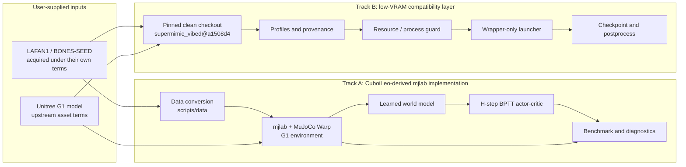
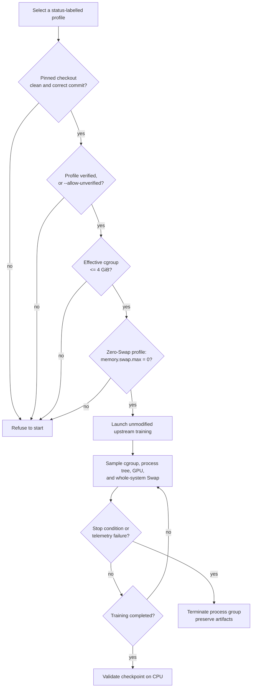
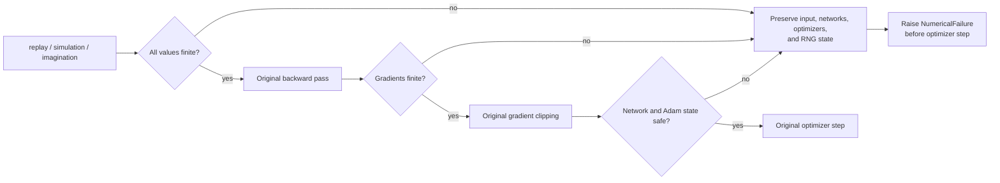
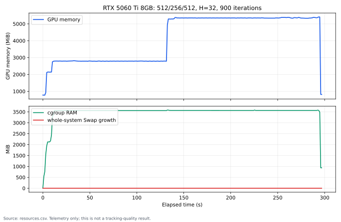

# Architecture and Experiment Flows

This document describes the public engineering boundary. It is deliberately more
conservative than the implementation: a component being present does not imply that an
end-to-end experiment has passed.

## Track Separation

Track B imports or copies no training implementation from this repository. Track A does
not call the Track B training path. Track A is derived from
`CuboiLeo/SuperMimic-Reproduced@d9be385`; diagram arrows describe runtime data flow, not
independent authorship.

## Low-VRAM Launch Flow

## Fail-Stop Protection Path

The guards do not replace values, skip a batch, or relax configured thresholds. They fail
closed and preserve diagnostics for analysis.

## Real Resource Evidence

The chart below contains measured RTX 5060 Ti 8GB resource telemetry from the retained
512/256/512, H=32, 900-iteration short run. It is not a convergence or tracking-quality
plot.

The source was the local `resources.csv` for
`vibed_local_20261027_vram512_01`. Raw telemetry remains private because it is part of the
local experiment workspace and is not part of the published source payload. The chart was
generated by `scripts/plot_vibed_resources.py`; no values were reconstructed.

## Missing Presentation Assets

No video, rendered rollout, or upstream demo GIF is included. Publishing those requires a
separate check of the motion, robot mesh, and rendering-asset licenses. An authorized
short CLI or dashboard screenshot can be added later if the owner confirms the underlying
data is publishable.
